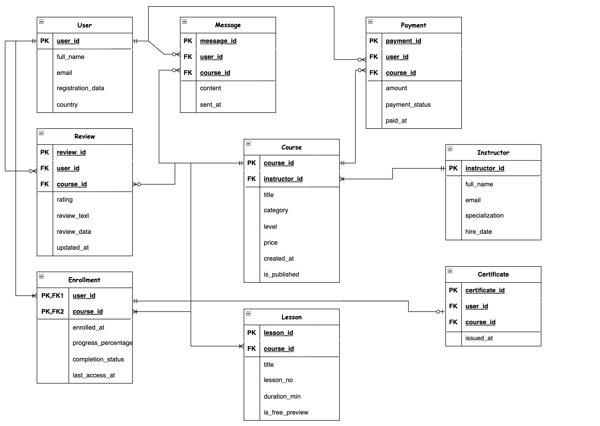

# Итерация 1. Проект БД: платформа онлайн-курсов

## Тема проекта
База данных платформы онлайн-курсов.

## Краткое описание предметной области
Платформа хранит информацию о пользователях, преподавателях, курсах и уроках. Пользователь может записываться на курсы, оплачивать их и оставлять отзывы на уже изучаемые курсы. После успешного завершения курса пользователь получает сертификат. Каждый курс создаётся одним преподавателем и состоит из набора уроков. Пользователи могут общаться с преподавателем курса, на который они записаны.

Эта база используется не только для хранения данных, но и для работы платформы:
- запись пользователей на курсы;
- хранение внутреннего устройства курса;
- отслеживание прогресса обучения;
- публикация отзывов и оценок;
- обработка платежей за курсы;
- выдача сертификатов об окончании курса;
- общение пользователей с преподавателями;
- аналитика по курсам и преподавателям.

## Основные сущности
1. **User** — пользователь платформы.
2. **Instructor** — преподаватель.
3. **Course** — курс.
4. **Lesson** — урок внутри курса.
5. **Enrollment** — запись пользователя на курс.
6. **Review** — отзыв и оценка курса.
7. **Payment** — оплата курса пользователем.
8. **Certificate** — сертификат об окончании курса.
9. **Message** — сообщение пользователя преподавателю в рамках курса.

Я выбрала 9 основных сущностей. При этом все сущности связаны между собой, а в модели есть как связи один-ко-многим, так и многие-ко-многим.

---

## Концептуальная модель

### Сущности
- **User**
- **Instructor**
- **Course**
- **Lesson**
- **Enrollment**
- **Review**
- **Payment**
- **Certificate**
- **Message**

### Связи между сущностями
- Один **Instructor** ведёт много **Course**.
- Один **Course** состоит из многих **Lesson**.
- Один **User** может записаться на много **Course**, и один **Course** может иметь много **User**. Эта связь реализуется через сущность **Enrollment**.
- Один **User** может оставить один **Review** на каждый курс, который он проходит. Отзыв можно редактировать.
- Один **Course** может иметь много **Review**.
- Один **User** совершает много **Payment**, каждый **Payment** относится к одному **Course**.
- Один **Enrollment** может иметь один **Certificate** — выдаётся при завершении курса.
- Один **User** может отправить много **Message** в рамках курса, на который он записан. Сообщения адресованы преподавателю этого курса.

---

## Логическая модель

### User
- **user_id** — PRIMARY KEY
- full_name
- email
- registration_data
- country

### Instructor
- **instructor_id** — PRIMARY KEY
- full_name
- email
- specialization
- hire_date

### Course
- **course_id** — PRIMARY KEY
- **instructor_id** — FOREIGN KEY -> Instructor.instructor_id
- title
- category
- level
- price
- created_at
- is_published

### Lesson
- **lesson_id** — PRIMARY KEY
- **course_id** — FOREIGN KEY -> Course.course_id
- title
- lesson_no
- duration_min
- is_free_preview
- UNIQUE(course_id, lesson_no)

### Enrollment
- **user_id** — PRIMARY KEY, FOREIGN KEY -> User.user_id
- **course_id** — PRIMARY KEY, FOREIGN KEY -> Course.course_id
- enrolled_at
- progress_percentage
- completion_status
- last_access_at

### Review
- **review_id** — PRIMARY KEY
- **user_id** — FOREIGN KEY -> User.user_id
- **course_id** — FOREIGN KEY -> Course.course_id
- rating
- review_text
- review_data
- updated_at
- UNIQUE(user_id, course_id)

### Payment
- **payment_id** — PRIMARY KEY
- **user_id** — FOREIGN KEY -> User.user_id
- **course_id** — FOREIGN KEY -> Course.course_id
- amount
- payment_status
- paid_at

### Certificate
- **certificate_id** — PRIMARY KEY
- **user_id** — FOREIGN KEY -> User.user_id (через Enrollment)
- **course_id** — FOREIGN KEY -> Course.course_id (через Enrollment)
- issued_at
- UNIQUE(user_id, course_id)

### Message
- **message_id** — PRIMARY KEY
- **user_id** — FOREIGN KEY -> User.user_id
- **course_id** — FOREIGN KEY -> Course.course_id
- content
- sent_at

---

## Физическая модель

### User
| Attribute | Description | Type | Constraints |
|---|---|---|---|
| user_id | идентификатор пользователя | INT | PRIMARY KEY |
| full_name | полное имя пользователя | VARCHAR(150) | NOT NULL |
| email | адрес электронной почты | VARCHAR(255) | NOT NULL, UNIQUE |
| registration_data | дата регистрации | DATE | NOT NULL |
| country | страна пользователя | VARCHAR(100) | |

### Instructor
| Attribute | Description | Type | Constraints |
|---|---|---|---|
| instructor_id | идентификатор преподавателя | INT | PRIMARY KEY |
| full_name | полное имя преподавателя | VARCHAR(150) | NOT NULL |
| email | адрес электронной почты | VARCHAR(255) | NOT NULL, UNIQUE |
| specialization | специализация | VARCHAR(120) | NOT NULL |
| hire_date | дата начала работы | DATE | NOT NULL |

### Course
| Attribute | Description | Type | Constraints |
|---|---|---|---|
| course_id | идентификатор курса | INT | PRIMARY KEY |
| instructor_id | идентификатор преподавателя | INT | NOT NULL, FOREIGN KEY (Instructor) |
| title | название курса | VARCHAR(200) | NOT NULL |
| category | категория курса | VARCHAR(100) | NOT NULL |
| level | уровень курса | VARCHAR(20) | NOT NULL, CHECK (level IN ('beginner', 'intermediate', 'advanced')) |
| price | стоимость курса | NUMERIC(10, 2) | NOT NULL, CHECK (price >= 0) |
| created_at | дата создания курса | DATE | NOT NULL |
| is_published | опубликован ли курс | BOOLEAN | NOT NULL |

### Lesson
| Attribute | Description | Type | Constraints |
|---|---|---|---|
| lesson_id | идентификатор урока | INT | PRIMARY KEY |
| course_id | идентификатор курса | INT | NOT NULL, FOREIGN KEY (Course) |
| title | название урока | VARCHAR(200) | NOT NULL |
| lesson_no | номер урока в курсе | INT | NOT NULL, CHECK (lesson_no > 0) |
| duration_min | длительность урока в минутах | INT | NOT NULL, CHECK (duration_min > 0) |
| is_free_preview | доступен ли урок как демо | BOOLEAN | NOT NULL |

Дополнительное ограничение для Lesson:
- UNIQUE (course_id, lesson_no) — номер урока уникален в рамках одного курса.

### Enrollment
| Attribute | Description | Type | Constraints |
|---|---|---|---|
| user_id | идентификатор пользователя | INT | PRIMARY KEY, FOREIGN KEY (User) |
| course_id | идентификатор курса | INT | PRIMARY KEY, FOREIGN KEY (Course) |
| enrolled_at | дата записи на курс | DATE | NOT NULL |
| progress_percentage | прогресс прохождения | NUMERIC(5, 2) | NOT NULL, CHECK (progress_percentage BETWEEN 0 AND 100) |
| completion_status | статус прохождения | VARCHAR(20) | NOT NULL, CHECK (completion_status IN ('active', 'completed', 'dropped')) |
| last_access_at | дата последнего доступа | TIMESTAMP | |

### Review
| Attribute | Description | Type | Constraints |
|---|---|---|---|
| review_id | идентификатор отзыва | INT | PRIMARY KEY |
| user_id | идентификатор пользователя | INT | NOT NULL, FOREIGN KEY (User) |
| course_id | идентификатор курса | INT | NOT NULL, FOREIGN KEY (Course) |
| rating | оценка курса | INT | NOT NULL, CHECK (rating BETWEEN 1 AND 5) |
| review_text | текст отзыва | TEXT | |
| review_data | дата публикации отзыва | DATE | NOT NULL |
| updated_at | дата последнего редактирования | TIMESTAMP | |

Дополнительное ограничение для Review:
- UNIQUE (user_id, course_id) — один пользователь может оставить не более одного отзыва на один курс. Отзыв можно редактировать, при этом обновляется поле updated_at.

### Payment
| Attribute | Description | Type | Constraints |
|---|---|---|---|
| payment_id | идентификатор платежа | INT | PRIMARY KEY |
| user_id | идентификатор пользователя | INT | NOT NULL, FOREIGN KEY (User) |
| course_id | идентификатор курса | INT | NOT NULL, FOREIGN KEY (Course) |
| amount | сумма платежа | NUMERIC(10, 2) | NOT NULL, CHECK (amount > 0) |
| payment_status | статус платежа | VARCHAR(20) | NOT NULL, CHECK (payment_status IN ('pending', 'completed', 'failed', 'refunded')) |
| paid_at | дата и время платежа | TIMESTAMP | NOT NULL |

### Certificate
| Attribute | Description | Type | Constraints |
|---|---|---|---|
| certificate_id | идентификатор сертификата | INT | PRIMARY KEY |
| user_id | идентификатор пользователя | INT | NOT NULL, FOREIGN KEY (User) |
| course_id | идентификатор курса | INT | NOT NULL, FOREIGN KEY (Course) |
| issued_at | дата выдачи сертификата | DATE | NOT NULL |

Дополнительное ограничение для Certificate:
- UNIQUE (user_id, course_id) — один пользователь получает не более одного сертификата на один курс.

### Message
| Attribute | Description | Type | Constraints |
|---|---|---|---|
| message_id | идентификатор сообщения | INT | PRIMARY KEY |
| user_id | идентификатор пользователя | INT | NOT NULL, FOREIGN KEY (User) |
| course_id | идентификатор курса | INT | NOT NULL, FOREIGN KEY (Course) |
| content | текст сообщения | TEXT | NOT NULL |
| sent_at | дата и время отправки | TIMESTAMP | NOT NULL |

Дополнительное ограничение для Message:
- Пользователь может отправить сообщение только в рамках курса, на который он записан — то есть должна существовать запись в Enrollment (user_id, course_id).

---

## Нормальная форма

База данных находится в **третьей нормальной форме (3НФ)**.

**1НФ** — все атрибуты атомарны, нет повторяющихся групп. Каждая таблица имеет первичный ключ.

**2НФ** — все неключевые атрибуты полностью зависят от первичного ключа. В таблицах с составным ключом (Enrollment, Certificate) каждый атрибут зависит именно от пары (user_id, course_id), а не от одного из ключей по отдельности.

**3НФ** — нет транзитивных зависимостей. Ни один неключевой атрибут не зависит от другого неключевого атрибута. Например, цена курса хранится в таблице Course, а не дублируется в Enrollment или Payment — в Payment хранится фактически уплаченная сумма на момент платежа.

---

## Почему модель подходит под требования проекта
- Есть 9 сущностей.
- Есть связь **1:M**: Instructor -> Course.
- Есть связь **1:M**: Course -> Lesson.
- Есть связь **1:M**: User -> Payment.
- Есть связь **1:M**: User -> Message.
- Есть связь **M:N**: User <-> Course через Enrollment.
- Есть отдельная сущность для отзывов, которую можно использовать в аналитических запросах.
- Есть сущность Payment для хранения истории оплат.
- Есть сущность Certificate, которая выдаётся при завершении курса.
- Есть сущность Message для общения пользователей с преподавателями в рамках курса.
- Модель легко расширяется, если позже понадобится добавить ассистентов, промокоды или систему уведомлений.
